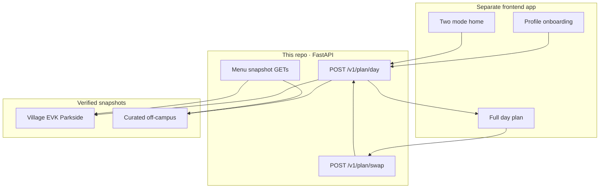

# TrojanPlate — Backend Architecture (USC)

**Product:** TrojanPlate  
**Tagline:** Your goals. Your campus. Your plate.  
**Repo role:** Backend API only (frontend is a separate app)  
**Hackathon scope:** USC University Park Campus — daily diet planning  
**Stack:** Python · FastAPI · SQLite · dated menu snapshots

Contract for frontend: [`docs/API_CONTRACT.md`](docs/API_CONTRACT.md)

---

## Design rules

1. **Primary product = daily meal planning** with two modes sharing one profile + one engine.
2. Recommendations use **verified menu snapshots** — never wait on live LLM for student requests.
3. Unknown nutrition / allergens stay unavailable — never invented.
4. Residential dining is **meal-swipe / AYCE**; do not price buffet components as purchases.
5. Hard constraints always beat ranking preferences.
6. Up to **three** recommendations per meal period; fewer is OK.

---

## Architecture

---

## Modes

| Mode | Data | Payment / budget |
|---|---|---|
| `usc_dining` | Village, EVK, Parkside snapshot | Meal swipes / Dining Dollars |
| `off_campus` | Curated nearby restaurants | Per-meal + daily cash; default 0.3 mi |

---

## Product HTTP API

| Method | Path | Purpose |
|---|---|---|
| `GET` | `/health` | Health |
| `GET` | `/v1/usc/overview` | Pitch + catalog stats |
| `POST` | `/v1/plan/day` | Full-day plan (≤3 recs per period) |
| `POST` | `/v1/plan/swap` | Swap a meal; replan remainder |
| `GET` | `/v1/menus/usc-dining` | Dining snapshot |
| `GET` | `/v1/menus/off-campus` | Off-campus curated set |

Legacy catalog endpoints (`/v1/suggest`, `/v1/meals`, …) remain as helpers.

---

## Data locations

| Path | Role |
|---|---|
| `data/menus/usc_dining/` | Dated residential dining snapshots |
| `data/menus/off_campus/` | Curated walkable restaurant menus |
| `data/pilot/` | Original pilot source for off-campus curation |
| `boundaries/` | DPS UPC GeoJSON |

---

## Bottom line

This backend turns **USC dining hall and nearby restaurant menus** into a **personalized daily plate plan API** for a separate TrojanPlate frontend.
