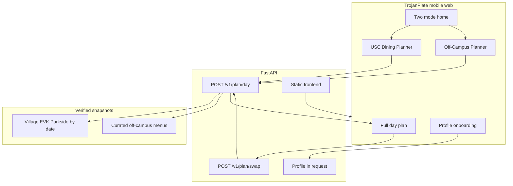

# TrojanPlate — Backend Architecture (USC)

**Product:** TrojanPlate  
**Tagline:** Your goals. Your campus. Your plate.  
**Hackathon scope:** USC University Park Campus — daily diet planning  
**Last updated:** 2026-11-14  
**Stack:** Python · FastAPI · SQLite · dated menu snapshots · Claude (background extract only, stretch)

Judging: [`docs/JUDGING.md`](docs/JUDGING.md) · Adoption: [`docs/ADOPTION.md`](docs/ADOPTION.md) · Roadmap alignment: product is **diet planning**, not generic restaurant discovery.

---

## Design rules

1. **Primary product = daily meal planning** with two modes sharing one profile + one engine.
2. App requests never wait on live LLM research. Recommendations use **verified menu snapshots**.
3. Unknown nutrition / allergens stay `null` or labeled unavailable — never invented.
4. Residential dining is **meal-swipe / all-you-care-to-eat**; do not price buffet components as separate purchases.
5. Hard constraints (allergies, exclusions, hard budget, distance) always beat ranking preferences.
6. Show **up to three** recommendations per meal period; fewer is OK — never pad with invented dishes.

---

## Product architecture

---

## Modes

| Mode | Data | Payment / budget | Distance |
|---|---|---|---|
| `usc_dining` | Village, EVK, Parkside snapshot | Meal swipes / Dining Dollars (visit-level) | Campus halls |
| `off_campus` | Curated nearby restaurants | Per-meal + daily cash budget | Default 0.3 mi straight-line |

---

## Planning engine

1. Load student profile + today’s situation (mode, periods, budget/swipes, location, cuisines).
2. Select catalog for the mode.
3. Hard-filter: allergies/exclusions, diet, meal period, budget, distance.
4. Rank: nutrition fit (known macros only), cuisine, cost/swipe fit, convenience, variety.
5. Emit ≤3 options per period with `why[]` and confidence labels.
6. On swap/select: lock chosen meals; replan remaining periods and remaining budget/swipes.

---

## HTTP API (product)

| Method | Path | Purpose |
|---|---|---|
| `GET` | `/` | Mobile-first TrojanPlate UI |
| `GET` | `/health` | Health |
| `GET` | `/v1/usc/overview` | Pitch + catalog stats |
| `POST` | `/v1/plan/day` | Full-day plan (≤3 recs per period) |
| `POST` | `/v1/plan/swap` | Swap a meal; replan remainder |
| `GET` | `/v1/menus/usc-dining` | Dining snapshot metadata + dishes |
| `GET` | `/v1/menus/off-campus` | Curated off-campus dishes |

Legacy catalog endpoints (`/v1/suggest`, `/v1/meals`, …) remain for low-level filters.

---

## Data locations

| Path | Role |
|---|---|
| `data/menus/usc_dining/` | Dated residential dining snapshots |
| `data/menus/off_campus/` | Curated walkable restaurant menus |
| `data/pilot/` | Original Claude pilot (source for off-campus curation) |
| `frontend/` | Mobile-first demo UI |
| `boundaries/` | DPS UPC GeoJSON (geographic honesty) |

---

## Bottom line

TrojanPlate turns **USC dining hall and nearby restaurant menus** into a **personalized daily plate plan** — grounded data, honest uncertainty, and a plan that updates when students swap meals.
