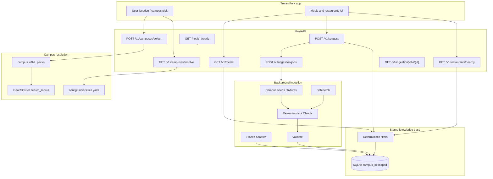

# Trojan Fork — Backend Architecture

**Product:** Trojan Fork  
**Last updated:** 2026-11-14  
**Stack:** Python · FastAPI · SQLite · Claude (background extraction only)

---

## Design rules

1. App requests **never** wait on full-campus LLM research. Return stored data fast; collect in background jobs.
2. **Campus is first-class.** USC is config, not a hardcoded dependency. Switching campuses does not change core discovery/extraction/recommendation code.
3. Official patrol boundaries ≠ food-discovery radius. Never present a radius as an official boundary.
4. Unknown nutrition stays `null`. Estimation disabled for this pilot. Constraints are never silently relaxed.

---

## Architecture diagram



---

## Campus packs

| Campus | Boundary | Notes |
|---|---|---|
| `usc_upc` | Official DPS patrol GeoJSON | First integration |
| `ucla_westwood` | Configurable `search_radius` (not official) | Second-campus pipeline test |

Add another university by dropping a YAML under `config/campuses/` and registering it in `config/universities.yaml`.

---

## HTTP API

```bash
uvicorn trojanbites_extract.api.app:app --reload --port 8000
```

| Method | Path | Purpose |
|---|---|---|
| `GET` | `/health` `/ready` | Health + campus list |
| `GET` | `/v1/campuses` | Configured universities/campuses |
| `GET` | `/v1/campuses/resolve` | Resolve from lat/lng |
| `POST` | `/v1/campuses/select` | Manual campus confirmation |
| `GET` | `/v1/restaurants` | Campus-scoped catalog |
| `GET` | `/v1/restaurants/nearby` | Nearby within campus |
| `GET` | `/v1/restaurants/{id}` | Detail + menu + macros |
| `GET` | `/v1/meals` `/v1/search/dishes` | Filtered dish search |
| `POST` | `/v1/suggest` `/v1/recommendations` | Nearby + meals (+ optional job) |
| `POST` | `/v1/ingestion/jobs` | Start campus collection |
| `GET` | `/v1/ingestion/jobs/{id}` | Job status |

Docs: http://127.0.0.1:8000/docs

---

## Pipeline

Location → Campus resolution → Geographic discovery → Restaurant matching → Menu-source discovery → Permitted retrieval → Parsing/OCR → Claude extraction → Validation → Storage → Search/recommendations

Adapters are replaceable: Places, web search, HTML/PDF/OCR, Claude, optional routing.

---

## Data locations

| Path | Role |
|---|---|
| `config/universities.yaml` | Multi-uni registry |
| `config/campuses/*.yaml` | Per-campus packs |
| `boundaries/` | Official GeoJSON boundaries |
| `data/pilot/` | USC Claude pilot input |
| `data/trojanbites.db` | Runtime SQLite |
| `exports/` | Generated JSON/MD |
| `STATUS.md` | Implemented / tested / deployed / blocked |

---

## Bottom line

Trojan Fork backend is a **multi-campus stored catalog** with **location→campus resolution**, **background ingestion jobs**, and **deterministic recommendations**. USC is the first pack; UCLA proves the same code path with a second config.
